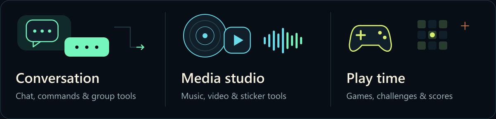

<div align="center">


### Your chat. A little more extraordinary.

**Music on demand. Worlds to play. Answers that move with you.**

<a href="https://pair.koyeb.app/"></a>
<a href="#hosting"></a>
<a href="#command-starter"></a>

<br/>

[](https://nodejs.org)
[](LICENSE)
[](https://github.com/SAFEME123/BASIL-MD/stargazers)
[](https://github.com/SAFEME123/BASIL-MD/network/members)

[Quick start](#quick-start) &nbsp; / &nbsp; [The toolkit](#explore-basil) &nbsp; / &nbsp; [Pocket Arcade](#pocket-arcade-and-weather-cards) &nbsp; / &nbsp; [Support](#support-and-contributions)

<sub>Original BASIL artwork · decorative animation, not live telemetry · <a href="docs/readme/hero-poster.png">view the still banner</a></sub>

</div>

<br/>

## More than a command list.



BASIL brings your music, games and everyday tools into the place you already talk. Queue a song, open a pocket-sized arcade, check tomorrow's weather or ask a better question—then get back to the conversation.

> **Start with `.menu`.** Explore what your installation supports, or jump straight to `.song`, `.gamesmenu`, `.weather` and `.ai`.

<details>
<summary><strong>Official project & mirror</strong></summary>

Use [SAFEME123/BASIL-MD](https://github.com/SAFEME123/BASIL-MD) for updates. The original `BOTMASTER350/BASIL-MD` account is currently unavailable.

</details>

## Explore BASIL

| Feature | What you can do | Start here |
|:---|:---|:---|
| **Native messages and media** | Send audio, video, documents, stickers and voice notes; choose the formats offered by each command | `.song`, `.video`, `.sticker`, `.tts` |
| **Music and downloads** | Search YouTube music, look up Spotify tracks and playlists, and retrieve supported social-media content | `.song <title>`, `.spotify <title or URL>` |
| **Movies and anime** | Search titles, browse recent releases and follow available episode or download choices | `.movie <title>`, `.latest`, `.anime <title>` |
| **Chatbot and AI tools** | Ask questions, work with text and images, summarize available conversation history, or request generated media | `.ai <question>`, `.chatbot`, `.tldr` |
| **Pocket Arcade** | Browse arcade, racing, puzzle, board and text games | `.gamesmenu`, `.dino`, `.chess` |
| **Weather** | Open an illustrated seven-day forecast with hourly detail, a city-local clock and Celsius/Fahrenheit options | `.weather London`, `.weather Harare f` |
| **Sports** | Browse reported match states, leagues, tables, news, highlights and available replays | `.sports football live`, `.sports leagues` |
| **Everyday tools** | Extract image text, translate, make QR codes, and review writing-style indicators | `.ocr`, `.translate`, `.qr`, `.aidetect` |
| **Group tools** | Configure welcome messages, polls and moderation; manage chatbot participation | `.menu` → group commands |
| **Pairing and dashboard** | Link your WhatsApp account and access the password-protected web dashboard | [Pair BASIL](https://pair.koyeb.app/), `/dashboard` |

**Availability:** downloads and AI generation depend on the source, provider limits and configured services. Rich cards, buttons and in-chat games depend on the receiving WhatsApp version. Some features offer text or document alternatives; a successful send does not guarantee that every client renders an interactive view.

## Quick start

### 1. Prepare your host

- Use **Node.js 20 or newer**. The supplied Docker image uses Node.js 22.
- Install **Git** and **FFmpeg** for media processing.
- Allow outbound internet access and provide writable storage for the running bot.
- Keep optional media/rendering dependencies installed for the full experience. If native modules cannot install on your system, use the supplied Docker image with its build libraries.

### 2. Link WhatsApp

1. Open the official [BASIL pairing page](https://pair.koyeb.app/).
2. Choose phone-number pairing or QR linking. Enter your number with its country code when requested.
3. In WhatsApp, open **Linked Devices → Link a Device**. Scan the QR, or select **Link with phone number** and enter the pairing code.
4. Complete linking and wait for the `SESSION_ID` in your WhatsApp self-chat. Save the complete value, including its `BASIL-MD~` prefix.

**A pairing code or QR image is not a completed session.** Codes expire; check WhatsApp before requesting another attempt. Link only an account you own or have permission to operate. Treat the session ID like a password.

### 3. Install and configure

```bash
git clone https://github.com/SAFEME123/BASIL-MD.git
cd BASIL-MD
npm install --include=optional --legacy-peer-deps
```

Create a private `config.env` file in the project directory, or set the equivalent environment variables in your hosting dashboard:

```dotenv
SESSION_ID="BASIL-MD~your-session-id"
OWNER_NUMBER="your-number-with-country-code"
PREFIX="."
MODE="public"
CHATBOT_MODE="false"
```

Replace both placeholders. `OWNER_NUMBER` is your WhatsApp number in international digits, without `+` or spaces. Never commit `config.env` or paste session credentials into issues or public chats.

### 4. Start the public distribution

```bash
node start.js
```

Use **`node start.js` as the public hosting start command**. Once WhatsApp is connected, send `.menu` and `.alive` from an allowed chat.

<details>
<summary>Working with a complete local source checkout?</summary>

`node index.js` applies only to a complete local source checkout that actually contains `index.js`. Its package scripts may also target that file. The public distribution starts through `start.js`; do not replace its start command with a source-checkout command or assume the two packages have identical npm scripts.

</details>

## Hosting

Use a persistent Node.js process or the supplied Docker image. Configure `SESSION_ID` and `OWNER_NUMBER` as private environment variables on the host.

| Host | Setup |
|:---|:---|
| [Railway](https://railway.app/) | Deploy the active GitHub repository. The project configuration uses `node start.js` and `/health`. |
| [Render](https://render.com/) | Deploy a Docker web service from the active repository; configure the required environment variables and `/health` check. |
| [Koyeb](https://app.koyeb.com/deploy?type=git&repository=github.com/SAFEME123/BASIL-MD) | Deploy the repository with Docker; expose port `3028` and use `/health`. |
| [Heroku](https://heroku.com/deploy?template=https://github.com/SAFEME123/BASIL-MD) | Review the deployment template and current plan requirements; ensure the process starts with `node start.js`. |
| **VPS or local machine** | Install the prerequisites, configure the environment and supervise `node start.js` with your chosen process manager. |

The default HTTP port is **3028**; use the host's `PORT` setting where provided. `/health` is a process health endpoint, not proof that WhatsApp pairing or every external feature is working. Host pricing, sleep policies and storage persistence vary by plan.

### Docker

From the cloned project directory, with your private `config.env` prepared:

```bash
docker build -t basil-md .
docker run -d --name basil-md \
  --env-file config.env \
  -p 3028:3028 \
  -v basil-data:/app/data \
  -v basil-session:/app/session \
  --restart unless-stopped \
  basil-md
```

This maps the default port and keeps the data and session directories in named volumes. Keep these volumes private and back them up as appropriate. For a public dashboard, configure HTTPS through your hosting platform or reverse proxy.

### Common settings

| Variable | Purpose |
|:---|:---|
| `SESSION_ID` | Complete session value received after linking |
| `OWNER_NUMBER` | Your WhatsApp number, country code included, digits only |
| `PREFIX` | Command prefix; default `.` |
| `MODE` | Bot scope: `public`, `groups`, `private` or `inbox` |
| `BOT_MENUMODE` | Menu presentation: `reply` or `button` |
| `TIME_ZONE` | Optional IANA timezone, such as `Africa/Harare` |
| `PORT` | HTTP port; default `3028` |
| `CHATBOT_MODE` | Startup chatbot setting; keep `false` until you are ready to enable replies |
| `AI_API_BASE` | Optional OpenAI-compatible API base URL for your chosen provider |
| `AI_API_KEY` | Your provider credential; keep it private |
| `AI_MODEL` | Model identifier supported by your provider |
| `WELCOME` / `GOODBYE` | Group join and leave messages |
| `AUTO_READ_STATUS` / `AUTO_READ_MSG` / `AUTO_REACT` | Optional automation; leave `false` unless intentionally enabled |
| `AUTO_STATUS_LIKE` | Optional status reactions; leave `off` unless intentionally enabled |

Set API credentials through the private environment configuration and restart the process after environment changes. Provider access, billing and model availability are governed by your provider.

## Command starter

Examples use the default `.` prefix. Replace it if you configured another prefix. Use `.menu` for the command list available on your installation; configuration and moderation commands require the appropriate permissions.

| Task | Example | How to use it |
|:---|:---|:---|
| Browse commands | `.menu` | Open the feature menu |
| Check responsiveness | `.ping` | View send-call timing and a runtime snapshot; this is not recipient delivery time or bandwidth |
| Find music | `.song song title` | Choose from the offered audio, document or voice-note options |
| Find a video | `.video search terms` | Follow the available quality choices |
| Look up Spotify content | `.spotify track title` | Search or supply a track/playlist URL |
| Find lyrics | `.spotify lyrics track title` | Returns matching lyrics when available |
| Make a sticker | `.sticker` | Reply to supported image/video media |
| Speak text | `.tts Hello from BASIL` | Generate speech through the configured service |
| Ask a question | `.ai Explain a solar eclipse` | Request an AI response |
| Configure chatbot replies | `.chatbot` | View settings for the current chat; use `.chatbot on` or `.chatbot off` where permitted |
| Summarize a conversation | `.tldr` | Summarize available recent group messages |
| Check weather | `.weather London c` | Open the saved forecast; use `f` for Fahrenheit |
| Browse games | `.gamesmenu` | Choose a game and send its command |
| Check football | `.sports football live` | List reported matches, then follow the numbered choices |
| Generate an ordinary QR | `.qr https://example.com` | Encode supplied text or a URL |
| Request a pairing code | `.pair <your-number>` | Use a private chat and complete the WhatsApp linking steps |
| Request a pairing QR | `.pairqr` | Use a private chat; scan the returned image before it expires |

### Media and downloads

BASIL includes commands for YouTube, Spotify, SoundCloud, TikTok, Instagram, Facebook, Threads, Pinterest and other supported sources. A source may return a downloadable file, a selection list, an informational link or an error. Only download and redistribute content you have permission to use.

- **Spotify playlists:** a playlist URL first lists metadata. Reply to the current card with displayed numbers such as `1,3,5`, or `all` for at most ten tracks. Downloads run sequentially after selection; listing a playlist does not download it automatically.
- **Music players:** artwork and matched lyrics accompany supported song results. Synchronized lyrics appear only when a matching timed source is available.
- **Movies, anime and sports:** follow the source's available choices. An embed or episode-page link is not necessarily a direct video download. Some sports media is supplied as a link because of its format, size or source.
- **Selections:** use the current prompt in the same chat. Numbered choices and buttons can expire; an old reply may no longer apply.

### Pocket Arcade and weather cards

| Experience | Try it | What to expect |
|:---|:---|:---|
| Arcade | `.dino`, `.flappy`, `.tetris`, `.invaders` | Short interactive games with their own on-screen controls |
| Action and racing | `.plane`, `.basilfighter`, `.highwayrush` | Space Striker, Rooftop Rumble and Highway Rush |
| Puzzles and boards | `.game2048`, `.memorygame`, `.chess`, `.checkers` | Puzzle and strategy choices; follow each game's instructions |
| Text games | `.tictactoe`, `.connectfour`, `.trivia` | Chat-based alternatives |
| Forecast cards | `.weather Tokyo` | Saved hourly/daily forecast data and a city-local clock |

Rich-game rendering depends on client support. The arcade library lets you copy a command and send it to launch the game. A weather card is a snapshot of the fetched forecast; its clock advancing does not refresh the weather data. Request weather again for a newer forecast.

### Chatbot and creative tools

In an enabled chat, try natural requests such as:

```text
Play Baby Shark on Spotify
What's the weather in London?
Show live football matches
```

Supported requests route to the corresponding command features and follow the chat's settings and permissions. Group admins can enable or disable group chatbot replies. Enable automation only where participants expect it; `.chatbot off` stops chatbot replies for that chat.

For creative tasks, explore `.imagine`, `.aimusic` and `.videogen`. Image, music, video and speech generation depend on the available providers and may require credentials or paid access. Review AI responses and generated content before relying on or sharing them.

The chatbot recognizes supported English group-description rules such as `No links`, `No stickers`, `No media` and `Banned words: exampleword`. With group-admin permission, matching moderation protections can be enabled in delete-only mode. Group admins can adjust them through the relevant commands; arbitrary description text is not a general instruction system.

## Privacy and consent

**Keep sessions, passwords and API keys private.** Do not include them in screenshots, support requests or shared logs. Review WhatsApp's Linked Devices list and unlink a session you no longer use.

| Feature | What to know before using it |
|:---|:---|
| **Pairing** | A QR image is a temporary snapshot. A chosen delivery recipient does not bind the QR to that phone number. Use the [pairing site](https://pair.koyeb.app/) for a refreshing QR and wait for the session ID after linking. |
| **Ordinary QR generation** | `.qr` encodes text/URLs. If local generation fails, external QR services may receive that content. Do not encode credentials or sensitive information. Use `.pairqr` specifically for account linking. |
| **Chatbot and media tools** | Selected services may process prompts, supplied media or relevant conversation context. Avoid sending private material without the affected people's permission. |
| **Website-to-APK** | Attach or reply to an icon and use `.web2apk https://example.com \| My App`. Review the website, app settings and icon-sharing prompt before confirming. Approval expires after 90 seconds; `.web2apk cancel` cancels a pending request or stops local tracking. A remote build may continue after tracking stops, and file checks do not certify app safety. |
| **Website AI indicators** | `.aidetect url https://example.com` asks for one-use confirmation of the exact URL and named provider, valid for two minutes. Follow the displayed confirmation command or use `.aidetect url cancel`. Scores are uncertain indicators, not proof of authorship. |
| **Preset URL processing** | `.preset <keyword>` searches; supplying a public TikTok URL asks for confirmation before sharing it with the processing service. Use the displayed token to confirm or cancel within two minutes. |

Confirmation applies to the request shown in that prompt. These specific consent flows do not mean that every bot command asks before contacting an external service.

## Dashboard

Open `/dashboard` on the bot's configured web address, or `http://localhost:3028/dashboard` when running locally with the default port. Use the Dashboard Access details sent to the bot's self-chat after setup.

The dashboard provides chat, media and supported account/group controls. Availability depends on the current WhatsApp connection. Keep the dashboard password private; `.resetpass` lets the configured bot owner regenerate it. Check the new access message before attempting to sign in again.

## Troubleshooting

| Symptom | Check |
|:---|:---|
| Startup reports a missing `index.js` | Set the public deployment start command to `node start.js`; source-checkout npm scripts may target a different entry point. |
| Pairing code or QR expired | Check Linked Devices and your self-chat first, then request a fresh attempt if needed. |
| No response to commands | Confirm the WhatsApp connection, prefix, bot mode and the command's permissions. Try `.menu` in an allowed chat. |
| Media processing fails | Check FFmpeg, optional dependencies, available disk space and whether the source still offers the requested content. |
| Buttons or a rich card do not display | Client support varies. Use the command's text/reply alternative where offered. |
| A provider rejects a request | Review the reported error, credentials and service limits; retry later if the provider is unavailable. |
| Settings disappear after redeployment | Check that the host retains the intended data/session storage across deployments. |

## Support and contributions

- [Project and updates](https://github.com/SAFEME123/BASIL-MD)
- [Report an issue](https://github.com/SAFEME123/BASIL-MD/issues)
- [Review or propose a contribution](https://github.com/SAFEME123/BASIL-MD/pulls)
- [Contributors](https://github.com/SAFEME123/BASIL-MD/graphs/contributors)

For a useful bug report, include the command, expected result, actual result, Node.js version, hosting method and a short **redacted** error excerpt. Remove phone numbers, chat content, session IDs, passwords and API keys before posting.

## Credits and license

**DEVSTRIKE TEAM** maintains the BASIL-MD project.

| Credit | Contribution |
|:---|:---|
| [SAFEME123](https://github.com/SAFEME123) | Lead Developer · Maintainer |
| [omoba-tife](https://github.com/omoba-tife) | Contributor · Feature Development |
| [Project contributors](https://github.com/SAFEME123/BASIL-MD/graphs/contributors) | Fixes, ideas and improvements |
| [Baileys](https://github.com/WhiskeySockets/Baileys) | WhatsApp connectivity library |

Licensed under the [MIT License](LICENSE). Copyright (c) 2025 DEVSTRIKE TEAM. Preserve the license and copyright notice when redistributing the software.

## Disclaimer

BASIL-MD is an independent project and is not affiliated with or endorsed by WhatsApp LLC or Meta Platforms, Inc. Unofficial WhatsApp automation can violate WhatsApp's terms and may result in account restrictions or suspension. Use the software responsibly, respect consent and content rights, and avoid unsolicited or bulk messaging. The software is supplied without warranty under the MIT License.
